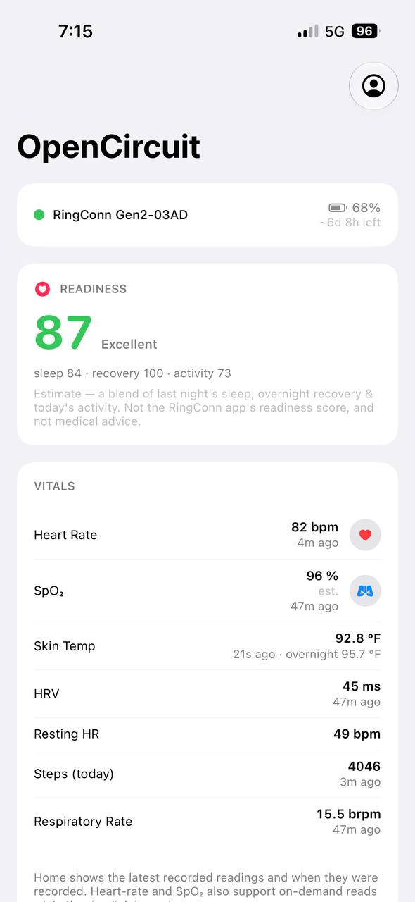
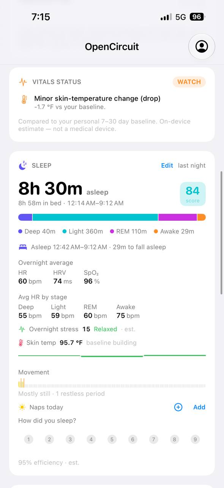
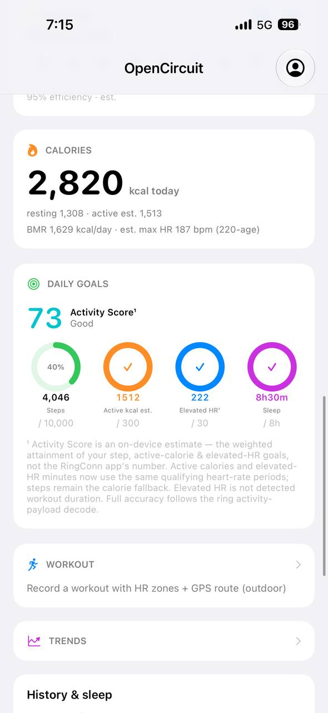
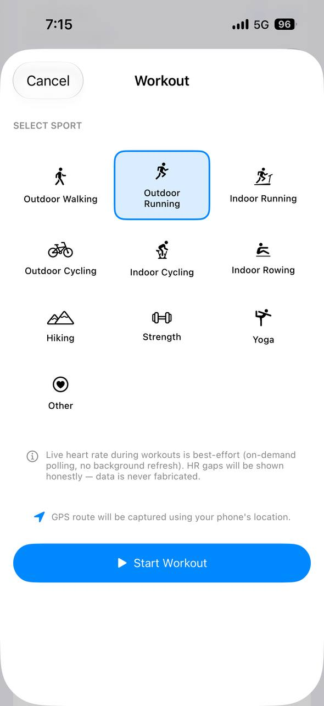
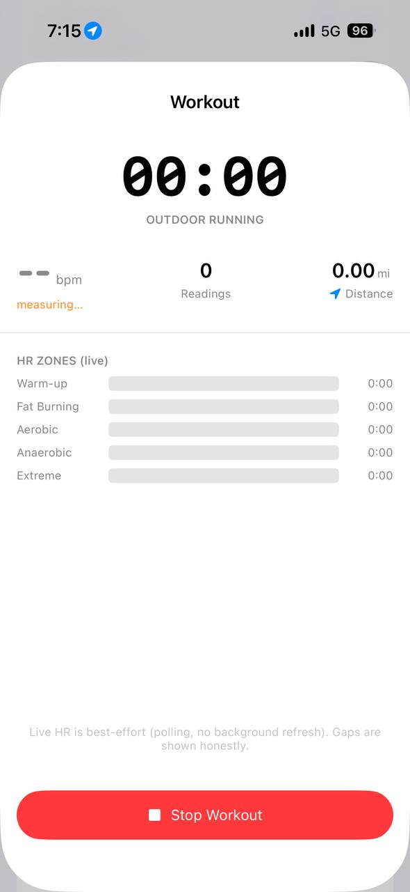

# OpenCircuit

**Local-first wearables: RingConn + Amazfit Helio.** No-cloud health data for the
**RingConn Gen 2/3 and Air** smart ring and the **Amazfit Helio Strap**: your iPhone reads the
metrics over Bluetooth LE, decodes them on the phone, and writes them to **Apple Health**.
Inspired by [openwhoop](https://github.com/bWanShiTong/openwhoop), which does the same for the
Whoop 4.0.

One wearable at a time: choose which one you wear on the first run, which shows its setup steps
(for a strap that isn't set up yet, it ends on the strap's setup screen, where saving the key
switches to it), or switch later in the app (Profile ▸ Device). Each device owns the time it was
chosen for, and only its readings for that time reach Apple Health and the daily totals; a night
belongs to the device you went to bed with. What the other device recorded in that time is never
written to Apple Health: the ring's readings are kept in the app, and the strap's are left on the
strap.

<a href="https://www.buymeacoffee.com/standardsoftware" target="_blank"></a>

BTC: bc1q2kxmf8l3qa29gftj6fxluk2svu0uufvle9pn44

> **OpenCircuit** is the user-facing name (home screen / store). The Xcode target,
> the bundle id (`com.standardsoftwaresolutions.opencircuit`), and the `OpenCircuitKit` Swift package
> keep their original internal names for continuity. See [`docs/ROADMAP.md`](docs/ROADMAP.md)
> for status.

> ⚠️ **Not affiliated with RingConn, Amazfit or Zepp.** OpenCircuit is an independent
> interoperability project — not affiliated with, authorized, or endorsed by RingConn, JZ_Tech,
> Amazfit or Zepp Health. "RingConn", "Amazfit", "Helio" and "Zepp" are trademarks of their
> respective owners. OpenCircuit is **not a medical device**. Privacy: [`docs/PRIVACY.md`](docs/PRIVACY.md) · License: [`LICENSE`](LICENSE) (PolyForm Noncommercial 1.0.0).

## Why this exists

The RingConn app sends your data to RingConn's cloud (AWS, UK), and the Zepp app ties the
Helio Strap to a Zepp account. OpenCircuit keeps your data on your devices: the wearable talks
BLE straight to a client you control, which writes into Apple Health. No subscription, no
third-party server.

## See it in action

<p align="center">
  
  
  
</p>
<p align="center">
  
  
</p>

<p align="center"><em>Dashboard, sleep and activity insights, and live workout tracking — all from data decoded locally from your RingConn.</em></p>

## What you get with a RingConn ring

Every metric below is decoded **on-device** from the ring's own Bluetooth stream and
written to **Apple Health** — nothing is sent to a server.

**Health metrics → Apple Health**

- ❤️ **Heart rate** — live, all-day, and during workouts
- 🫀 **Resting heart rate**
- 📈 **Heart-rate variability (HRV)** — on iOS 27 and later also as Recovery HRV
- 🩸 **Blood oxygen (SpO₂)**
- 🌬️ **Respiratory rate**
- 🌡️ **Skin temperature** (overnight)
- 👣 **Steps** + an active-energy estimate
- 😴 **Sleep** — duration plus an on-device sleep-stage *estimate* (the ring sends no
  stage labels, so staging is computed locally and clearly labeled "est.")

**Ring & charging-case status, live in the app**

- 🔋 Ring **battery %**, raw **voltage**, and **time-to-empty / time-to-full** estimates
- ⚡ **Charging detection** — knows the instant the ring is on the charger
- 🧳 **Charging-case battery %** and whether the case itself is charging
- 🖐️ **Wear detection** — auto-measurement pauses when the ring is off-wrist or charging

**How it connects**

- 🔗 **Standalone, no cloud key** — the ring's per-connection authentication is fully
  reverse-engineered (an SM3 challenge keyed only on the ring's *own* MAC), so OpenCircuit
  connects and streams on its own, with **no RingConn account or app ever needed**.
  Confirmed on a brand-new ring straight out of the box, before the official app had ever
  been installed (Gen 3, firmware FR05.005 — [issue #106](https://github.com/perezjuanj/OpenCircuit/issues/106)),
  as well as on rings already set up with the official app.
- 💍 Works with **any RingConn Gen 2 ring**, and **multiple rings per phone**.
- 🔄 Background sync, keepalive, and periodic auto-measure for continuous tracking.

## Amazfit Helio Strap

The Helio Strap stores its history on the strap and hands it over Bluetooth to an app that
proves it knows the strap's **auth key**. OpenCircuit speaks that protocol itself (Zepp OS,
written clean-room from [`docs/ZEPP_PROTOCOL.md`](docs/ZEPP_PROTOCOL.md)), so after a one-time
key setup the strap syncs with no Zepp app and no Zepp account in the loop. Only the **Helio
Strap** is supported (the app looks for that name; the Helio Ring is not tested).

**What works**

- **History sync → Apple Health.** Heart rate, HRV, SpO₂, sleep respiratory rate, skin
  temperature, steps and the strap's own sleep stages, plus active energy, resting heart rate
  and exercise minutes derived from the heart rate the same way as for the ring. Samples are
  written with the strap named as their device ("Helio Strap", Amazfit). Skin temperature is
  written only for minutes inside the strap's own sleep window when the strap was worn, and
  only between 30 and 42 °C. HRV is written as RMSSD, like the ring's, on Amazfit's statement
  that its devices measure HRV that way.
- **Background sync.** With the strap chosen, it syncs without the app being opened, through
  the same mechanisms as the ring: the app's background refresh and processing tasks, the
  optional "Sync after Sleep Focus" filter, and Bluetooth state restoration. iOS decides when
  background syncs run; hours can pass between them; pull to refresh syncs at once.
- **Nothing is deleted from the strap.** Every history round is acknowledged "keep"; the strap
  keeps its data whatever OpenCircuit does.
- **Find My Strap**: makes the strap vibrate, with Bluetooth signal strength as a distance
  hint. It stops after 60 seconds, and when you leave the screen or the app goes to the
  background.
- **Buzz the strap**: one short vibration.
- **Alarms**: the strap's alarm list, and adding, editing, turning on or off, or deleting one
  alarm at a time. OpenCircuit reads the list first and reads it back after each change.
- **Health alerts** (the strap's own high / low heart rate, low SpO₂ and relax reminders):
  shown read-only; editing them comes in a later version.
- **Live heart rate** for a minute, from the Today card.

The controls appear only when the strap reports that it supports them on that connection.

**What needs the key**

Everything above. Without a key OpenCircuit can show only live heart rate, and only if the
strap broadcasts the standard Bluetooth heart-rate signal without the key; otherwise it shows
nothing live. It never shows made-up data.

**Getting the key**

The key is created by Zepp's servers when you pair the strap in the Zepp app, so you need the
Zepp app once. If you sign in to Zepp with an **email and password**, tap **Get the key from my
Zepp account** in the strap's setup screen: OpenCircuit signs in once, reads the key, saves it and
signs out (your email and password aren't saved). Accounts that use Google, Apple or another
sign-in can't use that button; their one-time steps (a computer is needed) are in
[`docs/HELIO_KEY_EXTRACTION.md`](docs/HELIO_KEY_EXTRACTION.md). Or paste the key's 32
hexadecimal characters into OpenCircuit (spaces, colons and a leading `0x` are fine). It is
kept in the iOS Keychain on this phone only, and never shown again, logged or exported.

**Living with the Zepp app**

- Don't unpair the strap in the Zepp app; unpairing makes the key stop working.
- To let OpenCircuit connect, turn off Bluetooth for Zepp (Settings ▸ Zepp ▸ Bluetooth) or
  delete the Zepp app.

If the strap refuses the key, OpenCircuit says "Key rejected" and doesn't retry it until you
paste a new one. If another phone or app seems to hold the strap, it says "Strap busy" and
waits for you to try again (opening the app counts), or until the app is next launched, which iOS
may do in the background. That one retry per launch is how the strap comes back once Zepp lets go
of it.

**What stays in the app**

- **Stress** and **PAI** are shown in the app only: Apple Health has no type for them.
- The strap's own daily resting heart rate is kept on the phone but not written; Apple Health
  gets one resting heart rate a day, derived from the strap's heart rate like the ring's.

**Limits in this version**

- **One device at a time**: while the strap is chosen, the ring isn't scanned for, connected
  or synced, and the other way round.
- **No sleep stages for nights the strap didn't stage.** OpenCircuit uses the strap's own
  staging; a night the strap has no staging for is not staged, stored or written.
- **The strap's first sync starts when you switch to it.** Only on a phone that never used a ring
  does it reach back 7 days. So switch to the strap before bed if you want it to have tonight.
- Workouts recorded on the strap aren't imported.

## Use it alongside Bevel or Athlytic

OpenCircuit writes **standard Apple Health data types**, so any app that reads from
Apple Health can use your RingConn data — including recovery/readiness apps like
**Bevel** and **Athlytic** (both on the App Store), which normally pull from an Apple
Watch, Oura, or Whoop. OpenCircuit becomes the bridge:

```
RingConn Gen 2  →  OpenCircuit (BLE, on-device)  →  Apple Health  →  Bevel / Athlytic
```

Wear your RingConn, let OpenCircuit sync it to Apple Health, and get Bevel's or
Athlytic's recovery, readiness, strain, and sleep insights on top of **ring** data —
no Oura or Whoop subscription required.

The Helio Strap's data, HRV included, reaches Apple Health the same way.

## Local-first by design

- **Nothing leaves your phone** except the data you choose to write into Apple Health.
- **No RingConn cloud account, no subscription, no third-party server** — the ring talks
  BLE straight to a client you control. The Helio Strap needs a Zepp account once, to get its
  key (the optional in-app lookup is the only time OpenCircuit contacts Zepp); after that
  OpenCircuit talks only to the strap.
- All decoding and analytics run **on-device**; raw BLE captures used for protocol
  reverse-engineering are gitignored and never committed — only decoded *findings* live
  in [`docs/PROTOCOL.md`](docs/PROTOCOL.md) (RingConn) and
  [`docs/ZEPP_PROTOCOL.md`](docs/ZEPP_PROTOCOL.md) (Helio Strap).

## Architecture

```
┌─────────────────────── iOS App (Swift) — Phase 3+ ─────────────────────┐
│  CoreBluetooth  →  RingConn codec | ZeppKit  →  Analytics  →  HealthKit │
│                          ↕                                              │
│                    Local store (SwiftData) ── sync cursor              │
└────────────────────────────────────────────────────────────────────────┘
        ▲ protocol spec produced by ▼
┌──── desktop/  RE workbench (Python + bleak) — Phase 1–2 (current) ──────┐
│  sniff app traffic → dissect → replay commands → decode each metric     │
└─────────────────────────────────────────────────────────────────────────┘
```

Only openwhoop's **analytics** (sleep/HRV/strain detection) port across devices;
its BLE transport and packet parser are Whoop-specific and are rewritten here.
HealthKit only exists on iOS, and iOS BLE must use CoreBluetooth, so the final
data-writing app must be native Swift — the desktop workbench is the throwaway
tool that decodes the protocol first.

## Layout

| Path | What |
|---|---|
| `desktop/` | Python + `bleak` reverse-engineering workbench (Phase 1–2) |
| `desktop/captures/` | Raw BLE capture logs (gitignored) |
| `docs/PROTOCOL.md` | Living protocol spec — the primary deliverable of Phase 1 |
| `docs/ZEPP_PROTOCOL.md` | Amazfit Helio Strap (Zepp OS) clean-room protocol spec |
| `docs/HELIO_KEY_EXTRACTION.md` | Getting the Helio Strap's auth key |
| `docs/REVERSE_ENGINEERING.md` | How to capture and decode traffic |
| `docs/HEALTHKIT_MAPPING.md` | Each metric → its HealthKit type |
| `docs/ROADMAP.md` | Phases and current state |
| `ios/` | Swift app (created in Phase 3) |
| `ios/OpenCircuitKit/Sources/ZeppKit/` | The Helio Strap's protocol (auth, framing, history fetch, controls) |

## Get the code

```bash
git clone https://github.com/perezjuanj/OpenCircuit.git
cd OpenCircuit
```

## Quick start (desktop workbench)

Decoding an existing capture needs **no setup at all** — `decode-log` and the converter are
pure stdlib and run on the Python that ships with macOS:

```bash
cd desktop
python3 -m opencircuit decode-log captures/btsnoop_hci.log   # parse an Android HCI capture
python3 pcap_to_btsnoop.py capture.pcap                      # iPhone/Mac capture → btsnoop
```

Talking to a ring live needs `bleak`, and so needs a virtualenv:

```bash
cd desktop
python3 -m venv .venv-live
.venv-live/bin/pip install --upgrade pip      # macOS seeds pip 21.2.4, which can't
.venv-live/bin/pip install -r requirements.txt  # install the prebuilt pyobjc wheel

.venv-live/bin/python -m opencircuit scan     # find the ring, list services/characteristics
.venv-live/bin/python -m opencircuit listen   # connect and log every notification (hex)
```

> The checked-in `desktop/.venv` is Python 3.9.6 — make your own as above rather than
> reusing it. (On Windows the activate script is `.venv-live\Scripts\activate`.)

## Support

OpenCircuit is free and source-available. If it's useful to you, you can support development:

<a href="https://www.buymeacoffee.com/standardsoftware" target="_blank"></a>

BTC: bc1q2kxmf8l3qa29gftj6fxluk2svu0uufvle9pn44

## License

OpenCircuit is licensed under the [PolyForm Noncommercial License 1.0.0](LICENSE). You may
use, study, modify and share it for any noncommercial purpose (personal use, research,
hobby projects, education, charities and the like). Selling it, or using it in a commercial
product or service, is not allowed without a separate license from the copyright holder.

Copies released before this change were published under the MIT License and remain
available under it. Third-party code keeps its own license (see
[`docs/THIRD_PARTY_NOTICES.md`](docs/THIRD_PARTY_NOTICES.md)).

## Legal / safety

For interoperability and personal data ownership. You own the wearable and your data.
Don't redistribute RingConn or Zepp firmware or proprietary assets. The BLE protocol facts
in `docs/PROTOCOL.md` are observations of traffic from your own device; `docs/ZEPP_PROTOCOL.md`
is a clean-room specification with the source of every claim.
